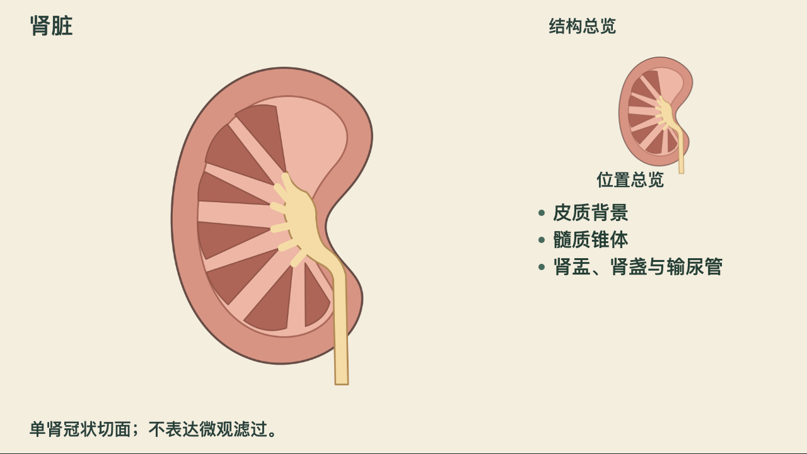

[中文](README.md) · [English](README.en.md)

# MAC Media Assets

**Characters, scenes, anatomy, and sound for medical explainer animation.**

MAC Media Assets is a public media library for clinicians, health educators, and medical content creators, and the companion library to [Med Auto Cast (MAC)](https://github.com/gaofeng21cn/med-autocast). It brings together hand-drawn collage elements, layered anatomy, character actions, everyday props, music, and sound effects, giving you a starting point so you can spend more time on the story and its presentation.

Let MAC find and import assets for your project, or download the source media for your own animation and editing tools.

| Characters and actions | Anatomy | Everyday life |
| :---: | :---: | :---: |
| [](payloads/paper-theatre/mac_young_man_seat_report_stand_v1/4e5c056cff995065ec14/samples/sample.mp4) | [](payloads/paper-theatre/mac_kidney_structure_reveal_v1/934d8f457b792794a078/samples/sample.mp4) | [](payloads/paper-theatre/mac_cooking_action_v1/1f97edf2520381c84d8f/samples/sample.mp4) |
| Sitting down, picking up a report, and standing up | From an overview to a layered explanation | From preparation to stirring and serving |

Select a preview image to open its MP4 sample.

[Browse all assets](docs/asset-inventory.md) · [Explore motion packages](docs/motion-studies.md) · [Get started](#get-started)

## What's in the library

Default discovery currently offers **294 assets and components across 11 categories**. Counts below refer to discoverable entries, with historical revisions counted once per asset; a component package can contain several source images.

| Category | Count | What you can use it for |
| --- | ---: | --- |
| Characters and poses | 75 | Choose adults, children, older people, pregnant women, and generic clinicians in standing, seated, reaching, and other poses |
| Anatomy | 55 | Explain organ locations and structural relationships with overviews, close-ups, and simplified illustrations |
| Motion and code components | 62 | Animate walking, sitting and standing, light assistance, home monitoring, and anatomical reveals and opening sequences |
| Scenes and stages | 26 | Build clinic, waiting-room, home, and kitchen scenes with doors, windows, tables, chairs, and beds |
| Food and lifestyle | 16 | Show meal composition, food preparation, cutting, and cooking |
| Tests and home monitoring | 15 | Assemble glucose meters, strips, blood-pressure monitors, cuffs, probes, and specimen tubes |
| Documents and time | 7 | Connect tests and follow-up visits with reports, notebooks, calendars, envelopes, and paper sheets |
| Paper and fasteners | 7 | Add paper textures, tracing paper, tape, clips, pins, and stamps |
| Treatment and care | 5 | Show medicine bottles, packaging, inhalers, and dressings |
| Music | 12 | Choose mood tracks, stems, and editable MIDI to support narration and pacing |
| Event sound effects | 14 | Add sound to paper contact, footsteps, sitting, clothing, instruments, and cooking |

## From assets to a shot

**Search for what you want to explain.** Discovery supports Chinese names, aliases, roles, poses, and actions. For home blood-pressure monitoring, look for a cuff, monitor, and wearing sequence. For a kidney explanation, start with an overview and choose layered assets for a closer view.

**Start with an assembly, then adjust its parts.** The library includes 17 assemblies and 14 event kits for situations such as handing over a report, recording follow-up, home monitoring, and preparing food. Motion packages include editable code, source media, and samples. Each package explains which parts can be separated and how they connect; adapt the composition, scale, timing, and sound to your story.

**Inspect the source before using it.** Previews help you judge style and suitability. Preserve provenance and version information when importing, then review proportions, contact, motion, sound, and medical meaning in your own shot. Adapt or create new material when the available assets do not fit.

## Get started

### Use with Med Auto Cast

Installing MAC through OPL also installs this library:

```bash
opl packages install med-autocast --json
```

Start a new MAC task and describe your topic, audience, and production folder. For example:

> "Make an explainer for patients starting to measure blood pressure at home. First find a monitor, cuff, and wearing sequence in the asset library. Show me suitable assets, then plan the shots."

MAC discovers and imports assets as the project needs them. See [Med Auto Cast](https://github.com/gaofeng21cn/med-autocast) for the full production workflow.

### Browse and download independently

Use the [asset inventory](docs/asset-inventory.md) to find source files, provenance, and reuse scope. After downloading the library, discovery and previews work offline. You need Git, Python 3.11 or newer, and a modern browser.

```bash
git clone --depth 1 https://github.com/gaofeng21cn/mac-media-assets.git
cd mac-media-assets
python3 tools/query_assets.py --query 肾脏 --limit 5
python3 tools/query_assets.py --character-role 老年男性 --pose seated --limit 5
```

These examples search for kidneys and a seated older man. Add `--json` for source-file paths, provenance records, and full metadata. Images, audio, and motion source code live in `payloads/`.

To play motion samples, scrub timelines, or listen to audio, serve the repository locally:

```bash
python3 -m http.server 8000 --bind 127.0.0.1
```

Then open [motion samples](http://127.0.0.1:8000/tools/preview-engine/motion.html), [assembly previews](http://127.0.0.1:8000/tools/preview-engine/index.html), or [music and sound effects](http://127.0.0.1:8000/tools/preview-engine/audio.html).

## Further reading

The detailed guides below are currently in Chinese.

- [Asset inventory](docs/asset-inventory.md): browse by category and find provenance records.
- [Motion packages](docs/motion-studies.md): choose character, anatomy, and everyday actions, with import instructions and scope.
- [Coverage and assemblies](docs/asset-coverage.md): explore character poses, combinations, and remaining gaps.
- [Preparing assets for a first draft](docs/first-draft-quality.md): search, inspect, and try a representative shot.
- [Maintenance and contribution](docs/README.md#维护验证): repository structure, asset registration, verification, and publication.

## License and provenance

Original tool code and documentation use [Apache-2.0](LICENSE). Media and third-party content retain their own recorded licenses, attribution requirements, and reuse scope. Read the corresponding source record before use; the code license does not change media rights. See [NOTICE](NOTICE).

The public library provides generic assets. Author-specific likenesses, licensed voice identities, private branding, and branded episode samples stay in their respective private author profiles. See [governance and review](docs/governance-and-review.md) for asset review scope.
