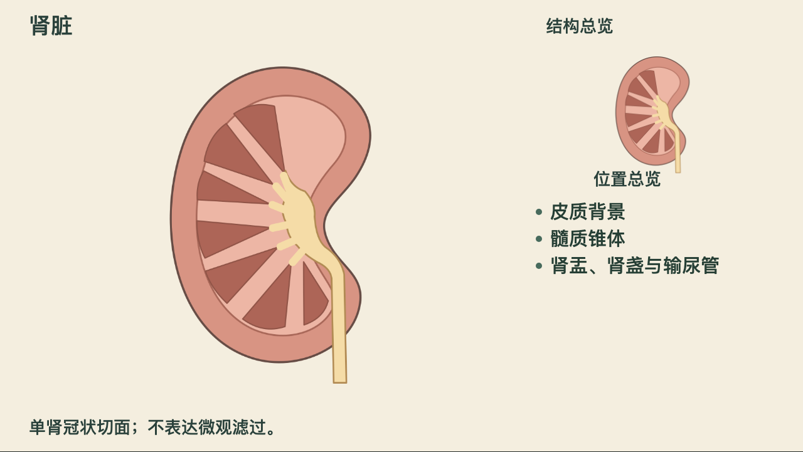

[中文](README.md) · [English](README.en.md)

# MAC Media Assets

**为医学科普动画准备角色、场景、结构与声音。**

MAC Media Assets 是面向医生、健康教育工作者和医学内容创作者的公开素材库，也是 [Med Auto Cast（MAC）](https://github.com/gaofeng21cn/med-autocast) 的配套素材库。这里有手绘拼贴纸件、可分层的医学结构、人物动作、生活道具、配乐与拟音，帮助你从已有素材开始，把时间用在故事和画面上。

你可以让 MAC 按制作需要检索和取用，也可以下载原件，在自己的动画或剪辑项目中使用。

| 人物与动作 | 医学结构 | 日常生活 |
| :---: | :---: | :---: |
| [](payloads/paper-theatre/mac_young_man_seat_report_stand_v1/4e5c056cff995065ec14/samples/sample.mp4) | [](payloads/paper-theatre/mac_kidney_structure_reveal_v1/934d8f457b792794a078/samples/sample.mp4) | [](payloads/paper-theatre/mac_cooking_action_v1/1f97edf2520381c84d8f/samples/sample.mp4) |
| 落座、取报告与起身 | 从总览到逐层解释 | 从备餐到翻炒、盛盘 |

点击预览图打开对应的 MP4 样片。

[浏览全部素材](docs/asset-inventory.md) · [了解动作包](docs/motion-studies.md) · [开始使用](#开始使用)

## 这里有什么

当前默认检索提供 **294 项素材与组件，覆盖 11 类**。下表按可检索条目计数，同一素材的历史版本不重复计算；一个部件包可以包含多张原图。

| 类别 | 数量 | 可以用来做什么 |
| --- | ---: | --- |
| 人物与姿态 | 75 | 选择成人、儿童、老人、孕妇和通用医生角色，搭配站立、坐姿、伸手等姿态 |
| 医学结构 | 55 | 用总览、解释近景和简化图讲解器官位置及结构关系 |
| 动作与代码组件 | 62 | 制作行走、坐站、轻扶照护、家庭监测，以及结构揭示与开合动画 |
| 环境与舞台 | 26 | 搭建诊室、候诊区、居家和厨房场景，组合门窗、桌椅与床 |
| 饮食与生活方式 | 16 | 呈现餐盘搭配、备餐、切配与烹饪 |
| 检查与家庭监测 | 15 | 组合血糖仪、试纸、血压主机、袖带、探头和标本管 |
| 资料与时间 | 7 | 用报告、记录本、台历、信封和纸页串起检查与随访 |
| 纸材与固定件 | 7 | 加入纸纹、描图纸、胶带、夹子、图钉和印章 |
| 治疗与照护 | 5 | 呈现药瓶、包装、吸入器与敷料 |
| 配乐 | 12 | 选择情绪配乐、分轨和可编辑 MIDI，配合旁白调整节奏 |
| 事件拟音 | 14 | 为纸件接触、脚步、落座、衣料、器械和烹饪动作配声 |

## 从素材到镜头

**按想表达的内容找素材。** 可以搜索中文名称、同义词、角色、姿态或动作。例如，讲家庭血压监测时，寻找袖带、主机与佩戴动作；解释肾脏时，先看结构总览，再选择适合近景讲解的分层素材。

**从组合开始，也能逐件调整。** 库内有 17 组装配和 14 组事件组合，涵盖报告交接、随访记录、家庭监测和备餐等情境。动作包附带可编辑代码、原件和样片；部件如何拆分、怎样连接，见各包说明。你可以按自己的故事调整构图、比例、时长和声音。

**先看原件，再放进作品。** 预览帮助你判断风格与表达是否合适；取用时保留来源和版本，并在当前镜头中复核人物比例、接触关系、动作、听感和医学表达。没有合适素材时，可以适配或新创。

## 开始使用

### 随 Med Auto Cast 使用

通过 OPL 安装 MAC 时，会一并安装本库：

```bash
opl packages install med-autocast --json
```

安装后，在新的 MAC 任务中说明主题、受众和制作目录，例如：

> “为刚开始居家测血压的患者制作一段科普动画。先在素材库里查找血压计、袖带和佩戴动作，给我看合适的素材，再设计分镜。”

MAC 会按项目需要检索和取用素材。完整制作流程见 [Med Auto Cast](https://github.com/gaofeng21cn/med-autocast#安装与开始使用)。

### 独立浏览与下载

也可以直接在[素材清单](docs/asset-inventory.md)中找到对应记录，查看原件位置、来源与使用范围。下载全库后，查询和预览可离线进行；需要 Git、Python 3.11 或更新版本，以及现代浏览器。

```bash
git clone --depth 1 https://github.com/gaofeng21cn/mac-media-assets.git
cd mac-media-assets
python3 tools/query_assets.py --query 肾脏 --limit 5
python3 tools/query_assets.py --character-role 老年男性 --pose seated --limit 5
```

加上 `--json` 可查看原件相对路径、来源记录和完整字段。图片、声音与动作源码位于 `payloads/`。

要播放动作、拖动时间轴或试听声音，在仓库根目录启动本地预览：

```bash
python3 -m http.server 8000 --bind 127.0.0.1
```

然后打开[动作样片](http://127.0.0.1:8000/tools/preview-engine/motion.html)、[装配预览](http://127.0.0.1:8000/tools/preview-engine/index.html)或[配乐与拟音](http://127.0.0.1:8000/tools/preview-engine/audio.html)。

## 进一步了解

- [素材清单](docs/asset-inventory.md)：按类别查找素材与来源记录。
- [动作包说明](docs/motion-studies.md)：选择人物、医学结构和生活动作，了解取用方式与适用范围。
- [覆盖与组合](docs/asset-coverage.md)：查看角色姿态、可重组组合和现有缺口。
- [制作前的素材准备](docs/first-draft-quality.md)：从检索、实看到代表镜头试装。
- [维护与贡献](docs/README.md#维护验证)：目录结构、素材登记、校验与发布入口。

## 许可与来源

原创工具代码和文档采用 [Apache-2.0](LICENSE)。媒体原件及第三方内容按各自记录的授权、署名和复用范围使用，取用前请查看对应来源记录；仓库代码许可证不改变媒体授权，详见 [NOTICE](NOTICE)。

公共库提供通用素材。作者专属形象、授权声线、私人品牌包和带品牌样片由各自的私有作者档案保管。素材的审看范围见[治理与审看说明](docs/governance-and-review.md)。
