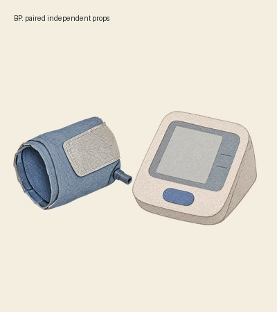
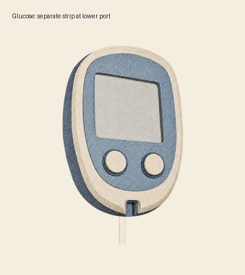

# MAC Media Assets · 医学科普纸剧场资产库

这是 [Med Auto Cast（MAC）](https://github.com/gaofeng21cn/med-autocast) 的独立媒体库：为医学科普动画保存可拿起、摆放、交接和拼贴的纸件，以及纸景、动作组件和配乐。用户把选题和创意交给 MAC，MAC 自动检索原件，按故事选择、适配或新创。

## 有哪些资产

| 类别 | 代表素材 | 可以怎样使用 |
| --- | --- | --- |
| 医学结构纸件 | 垂体与邻近结构、头部矢状位、甲状腺、肾脏与泌尿系统、乳腺切面、足关节、盆腔器官 | 整体取放、结构总览、局部观察；内部运动另准备分层 |
| 检查与家庭监测 | 上臂式血压计主机与袖带、血糖仪主机与独立试纸 | 部件分别摆放，试纸独立进入仪器；屏幕保持空白 |
| 用药与自我照护 | 无标签琥珀药瓶、独立白色瓶盖 | 瓶盖与瓶身分别运动，适配不同故事 |
| 纸材与固定件 | 手撕纤维纸胶带、毛边报告纸、纸质观察窗、木印章 | 局部固定、揭开、落印与纸面叠贴 |
| 资料与随访物件 | 纸信封、可开合与收纳的无品牌纸夹组件 | 资料交接、归档、前景遮挡与跨镜承接 |
| 完整纸景 | 医院入口、实验室、居家墙面，以及卧室、客厅、诊室和桌面场景 | 作为完整后景组织纸剧场；烘焙在图内的家具不独立运动 |
| 动作与代码组件 | 印章接触、纸件交接、纸口袋收纳、纸夹打开与夹持、舞台及媒介技法样例 | 为新镜头提供可适配的动作与实现起点 |
| 音乐与声音源 | 通用氛围与节奏分轨、六主题原创配乐、垂体瘤配乐工程 | 按情绪试听、剪辑和混音；保留原声、分轨及可编辑来源 |

具体原件、版本与操作范围见[资产清单](docs/asset-inventory.md)。[覆盖评估与储备计划](docs/asset-coverage.md)说明各类别已有什么、还缺什么。

## 部件预览

以下是用于独立操作的分层原件，不是扁平化的场景插画。每套带部件来源、实际内容边界、接触位置与装配说明。

<table>
<tr><th>血压计：主机 / 袖带</th><th>血糖仪：主机 / 试纸</th><th>药瓶：瓶身 / 瓶盖</th></tr>
<tr><td></td><td></td><td></td></tr>
</table>

各图为静态装配审看样例；真实部件分别保存，当前镜头可重新设计比例、位置和动作。

## 素材来自哪些系列

积累来自 11 个系列：垂体瘤、糖尿病、高血压、科学减重、血脂管理、高尿酸与痛风、Graves 病、桥本甲状腺炎、乳腺结节、多囊卵巢综合征、慢性肾病。这是素材的来源覆盖，不代表每个主题都已有完整可拆素材包。

当前可复用候选为 **45 个版本包、316 个载荷文件**，包括：10 张完整后景、14 个单件/完整图件、3 套分层包（6 个独立透明部件）、7 个代码/动作版本包、10 个声音/音乐版本包，以及1个作者品牌快照。参考区另保留72张历史关键帧与10个退出推荐版本。

历史关键帧、存在复用缺陷的原件和被替代版本保留在参考区，供恢复与追溯，**不进入默认素材推荐，也不计入可用库存**。完整纸景与整幅医学结构图按其整体用途保管，不能冒充可拆层。

## 提供起点，保留创作空间

MAC 先看原件，再决定是否适合当前故事。库不规定镜头数、构图、比例、颜色或复用率；没有合适素材时，继续寻找或生成新素材。分层、透明与文件完整性提供制作基础，当前镜头的叙事、动态、医学表达和声音仍由实际审看判断。

作者专属的品牌与音乐快照只供对应作者使用；医生形象、授权声线和品牌基线由作者档案管理。

维护与调用说明：[库 Skill](skills/mac-media-assets/SKILL.md) · [资产治理](docs/governance-and-review.md) · [初稿质量](docs/first-draft-quality.md)。
