# 当前装配与事件动作窗口

当前代码在本地Chrome执行，21个样例各12个姿态；截图用于观察接触、比例、遮挡与动作窗口，不替代正常速度完整观看、医学或混音审查。

## door

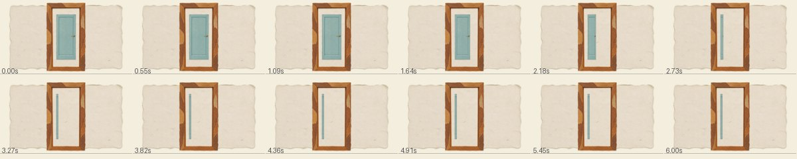

## calendar

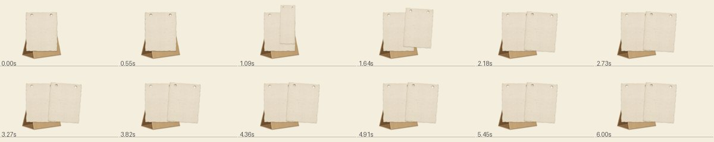

## notebook

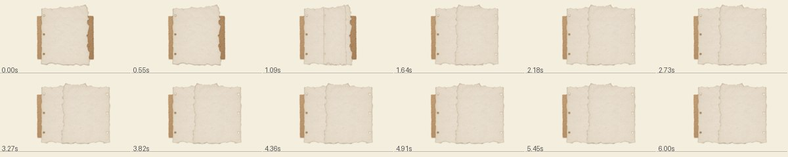

## specimen

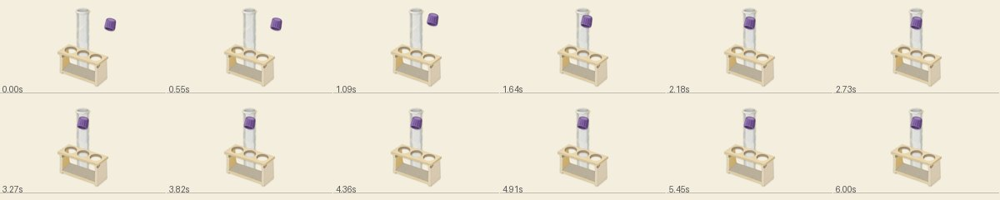

## bed

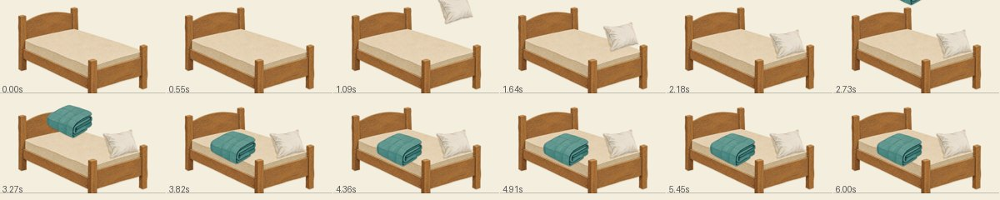

## room

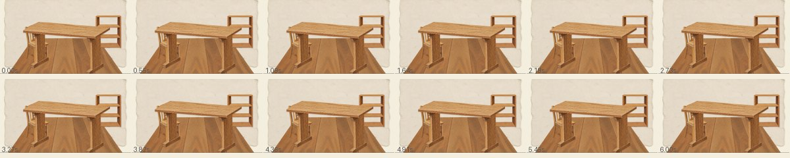

## meal

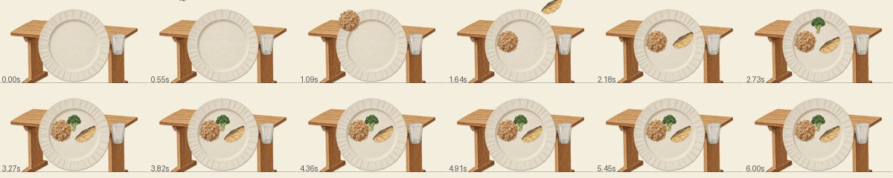

## pose

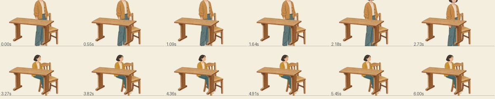

## anatomy_focus

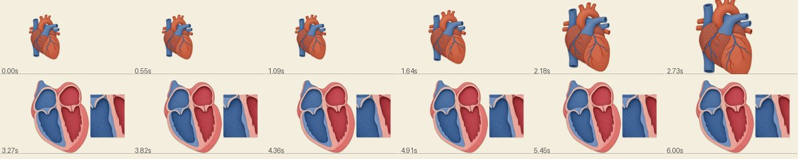

## glucose

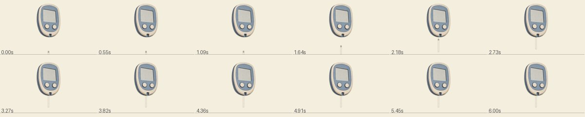

## pressure

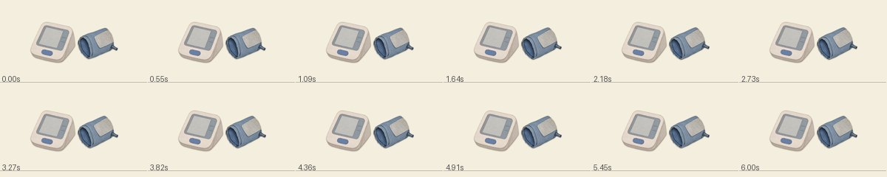

## medicine

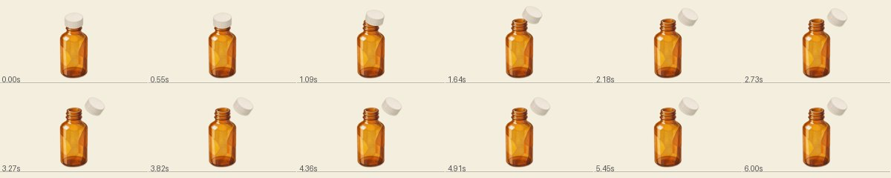

## cuff_contact

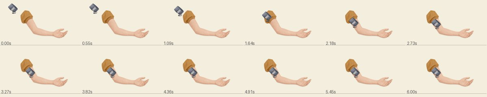

## report_handoff

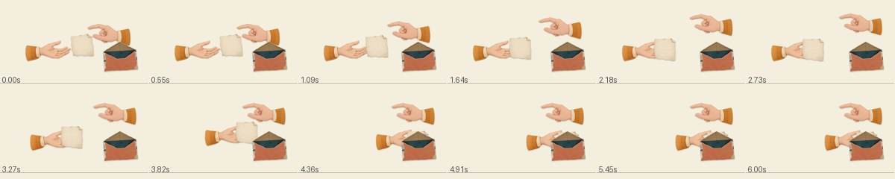

## followup

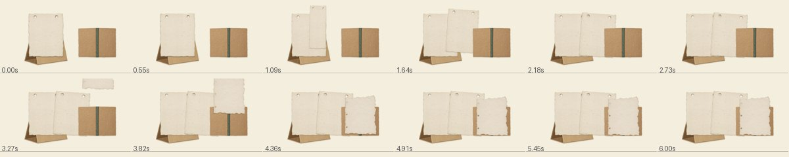

## evidence_compare

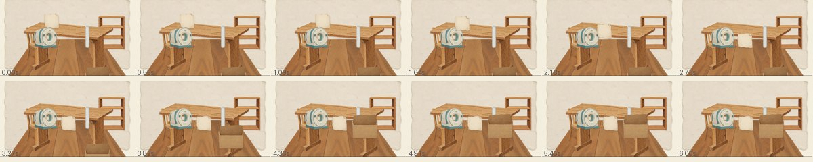

## medicine_action

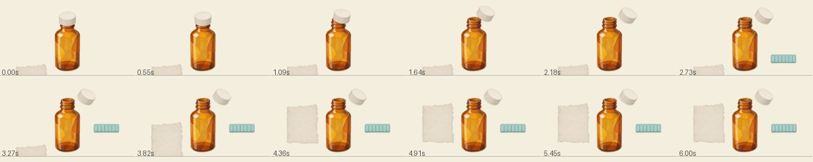

## glucose_action

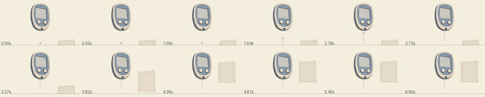

## daily_activity

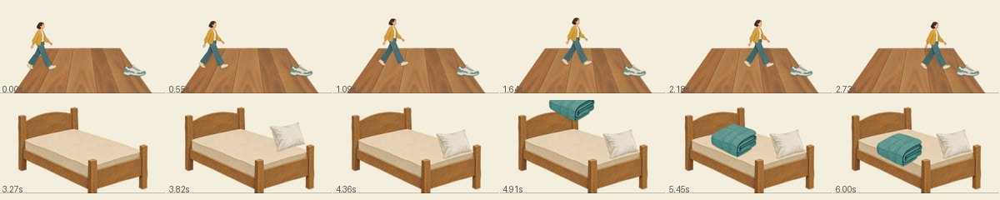

## meal_action

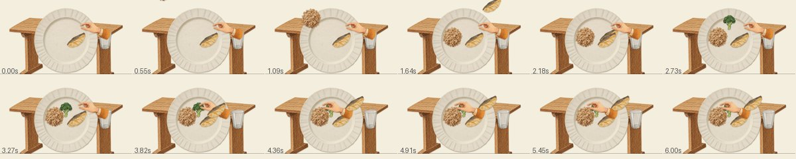

## structure_focus

